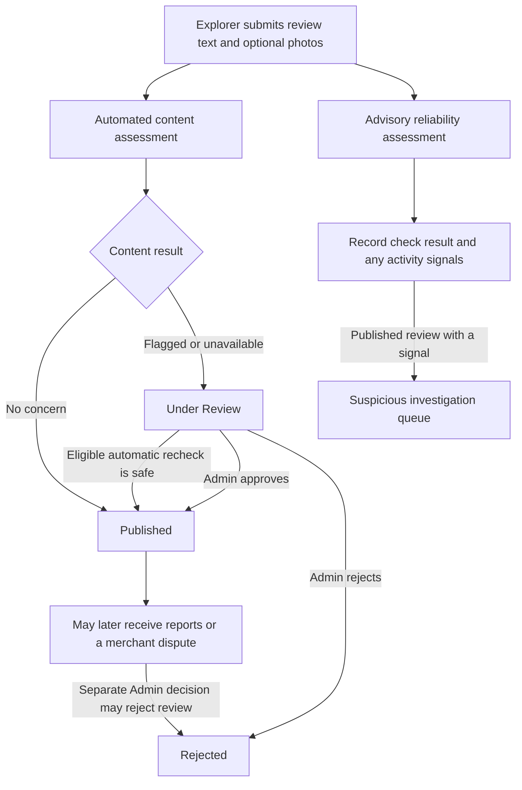

# Review Moderation & Integrity in SugboGo

## Introduction

Community reviews help Explorers choose places to visit and help merchants understand visitor experiences. Because reviews are written by community members, SugboGo must also handle potentially harmful content, unusual submission patterns, community concerns, and merchant challenges. The **Review Moderation & Integrity** system brings these concerns to administrators through four related but distinct workspaces: **Under Review**, **Suspicious**, **Reported**, and **Disputes**.

Explorers contribute reviews and can raise concerns about other people's published reviews. Merchants can respond to reviews of their businesses and formally dispute eligible reviews. Administrators examine the available evidence and make the decisions supported by each workflow. Automated checks help identify material requiring attention; they do not establish whether every statement in a review is true.

## Objectives

The system is intended to:

- Assess newly submitted review text and photos for potentially inappropriate content.
- Identify unusual review activity without automatically punishing a reviewer.
- Give community members a structured way to report concerns.
- Give merchants a formal way to challenge reviews of their businesses.
- Give administrators the review, findings, reports, dispute explanations, and available history needed for a reasoned decision.
- Preserve recorded evidence and decisions while protecting legitimate participation.

## Review submission and publication lifecycle

An authenticated Explorer or Merchant account can submit a review, but a merchant cannot review their own business. A user may review a particular business only once. A new review requires written text and may include photos. SugboGo assesses the submitted text and each photo for content concerns. It separately assesses the review for advisory reliability patterns.

The **content assessment** determines the initial publication path. If it completes without a concern, the review is **Published** and can appear in normal review listings. If content is flagged, or the assessment cannot be completed, the review is **Under Review** and awaits an appropriate result or administrator decision. A provider failure can trigger a limited automatic recheck: a completed safe recheck can publish the review, while a flagged result or exhausted rechecks leave it held for administrator review. A review is not rejected automatically merely because automated moderation found a concern or was unavailable.

The **reliability assessment** runs independently during submission. It records unusual patterns and a check outcome but does not decide publication. A published review with a recorded reliability signal can also appear in the Suspicious workspace. Published reviews can subsequently receive community reports or merchant disputes.

| Review status | Meaning in the current workflow |
| --- | --- |
| **Published** | Available through normal published-review views. It can still be reported, disputed, or investigated for recorded reliability signals. |
| **Under Review** | Held before publication because content was flagged or the automated assessment could not be completed. An eligible automatic recheck or an Admin decision may publish it; an Admin may reject it. |
| **Rejected** | Excluded from normal published-review views after an administrator decision. Earlier reports, disputes, and reliability observations are not erased merely by the status change. |

SugboGo also recognizes a **Flagged** review status, but the current new-review submission and Under Review decision path does not assign it as a routine outcome. It should not be confused with a reliability signal or a community-report attention indicator.

Review authors can edit review text or photos after submission, except while the review is **Under Review**. Proposed changes to text or newly added or replacement photos receive automated content assessment before they are saved. Safe edits are accepted; concerning content or an unavailable assessment leaves the previously published review unchanged. Removing a photo or changing only the community visibility preference does not require another content assessment. Blocked edits are not sent to the Admin Under Review queue. A changed text may separately be checked for a newly detectable **Duplicate Content** reliability signal after the edit is accepted; earlier reliability observations remain recorded. An author can also delete their review, which removes the review rather than creating a moderation decision.

Merchants can provide a reply to a review of their own business. The review and any available reply are shown as context in the administrator investigation panels.

## Under Review: AI content moderation

### Purpose and assessment

The Under Review workflow addresses the **content of a newly submitted review**. SugboGo assesses the written text and each submitted image separately. Findings may identify potentially inappropriate categories, such as abusive, threatening, or violent content. A narrow local check also recognizes certain direct Cebuano threats in text. Findings identify content for human attention; they do not establish a person's intent or prove a policy violation by themselves.

When every applicable automated assessment completes without a concern, the review is published without requiring every review to be manually approved. When concerning content is detected, the review is held. If the automated provider cannot complete its assessment, SugboGo also holds the review rather than treating an unchecked item as safe. A limited automatic recheck is available for eligible provider failures. If those attempts do not produce a safe result, the held review remains available for direct administrator assessment. There is no manual retry button in the Under Review decision flow.

### Administrator investigation and decision

The **Under Review** queue contains reviews currently held before publication. Its investigation panel shows the review author, business, text, photos, and any available reply, followed by the moderation findings. Administrators can see whether a concern was found in the review text or a particular photo and whether the automated check was incomplete. Findings are supporting evidence, not a substitute for reading the content.

An administrator can choose **Approve & Publish** after a simple confirmation, or **Reject Review** after providing internal moderation notes explaining the decision. Rejection notes require meaningful written context; approval does not require notes. Both decisions are recorded in the administrative activity trail. Approval makes the review published. Rejection leaves it out of normal published-review views. These decisions use the review's established publication and rejection behavior rather than a separate reliability decision.

## Suspicious: Review Reliability

Review Reliability looks for **submission patterns**, not inappropriate words or images. It records three advisory signals:

| Signal | Plain-language trigger |
| --- | --- |
| **Duplicate Content** | A review's normalized wording matches at least **two earlier reviews** associated with the same author or app installation, each concerning a different business from the current one, within **30 days** before detection. A changed review text can first trigger this signal during an edit. |
| **Rapid Submission** | More than **10 reviews** from one app installation fall within the **24 hours** ending at the check; the newly submitted **11th** review can trigger it. |
| **Shared Installation Accounts** | More than **three distinct accounts** associated with one app installation have reviewed the **same business**; the fourth distinct account can trigger it. This signal has no rolling time limit. |

The recorded **Reliability Check** result is **Checked** when an applicable assessment completed, **Unavailable** when it could not be completed, or **Unknown** when a historical completion result was not recorded. These results describe the check, not whether a review is truthful. A historical review may have a recorded signal alongside an Unknown check result. An unavailable assessment is neither a clean result nor evidence of misconduct.

The **Suspicious** queue shows **published reviews with recorded signals**. Its read-only investigation panel shows the review and its **Suspicious Activity Signals**, the separate **Reliability Check** result, **Why This Review Was Flagged** (observations recorded at detection), and **Current Related Activity** (related records still available now). Current activity may differ after another review is edited, rejected, or deleted. Administrators should not interpret an app installation identifier as proof that several accounts belong to one person.

No Suspicious-workspace action automatically approves, rejects, removes, or penalizes a review or account. For more detail on the three rules and historical evidence, see [Review Reliability in SugboGo](review-reliability.md).

## Reported: Community reporting

### Submitting a report

Community reporting lets an authenticated Explorer or Merchant account raise a concern about **another person's published review**. A user cannot report their own review and can submit only **one report per review**, including after that report is resolved. The reporting form requires an explicit submission after selecting one of six reasons:

| Available reason | Explanation rule |
| --- | --- |
| Spam | Optional |
| Abuse or Harassment | Optional |
| False or Misleading Information | Optional |
| Off-topic or Irrelevant | Optional |
| Personal or Private Information | Optional |
| Other | Required |

Any written explanation must be **10–500 characters after trimming**; an empty explanation is valid for the five preset reasons. A submitted report starts as **Pending**. The reporting user can later view their own report receipt, including the reason, any explanation, submission date, and a user-facing **Submitted** or **Reviewed** state. A historical withdrawn report is labeled **Withdrawn**. Reporter identity and explanations are not shown to other community members.

### Attention threshold and investigation

When a **published review** has **at least three pending reports**, SugboGo marks it for elevated report attention. Because each user can report a review only once, those pending reports represent distinct reporting users. The threshold is an attention cue only: reports do **not** automatically hide or reject a review. A review with even one pending report can appear in Reported; the queue groups reports into **one item per review**, rather than making each report a separate administrator task. An already-rejected review can remain in the queue if reports submitted earlier are still pending.

The **Reported** investigation shows the review and its content, a Community Reports summary with pending counts and reasons, the individual pending reports and any reporter explanations, and previous resolved reports when the group remains active. First and latest report times provide context. Reports are allegations, not confirmed violations, and reporter identities are not displayed in the investigation.

### Administrator resolution

Administrators resolve **all currently pending reports for that review together** and provide internal decision notes. Previously resolved or withdrawn reports remain unchanged.

| Review when Admin decides | Available action | Result |
| --- | --- | --- |
| **Published** | **Keep Review** | The review stays published; all currently pending reports are dismissed. |
| **Published** | **Reject Review** | The review is rejected through the normal review rejection process; all currently pending reports are confirmed. |
| **Already rejected** | **Confirm Reports** | All currently pending reports are confirmed; the review remains rejected. |
| **Already rejected** | **Dismiss Reports** | All currently pending reports are dismissed; the review remains rejected. |

Confirming or dismissing reports on an already-rejected review does not republish or reject it a second time. Individual report records remain available as historical evidence; no report is deleted merely because the group was decided. Once no pending reports remain, the review leaves the active Reported queue. The decision is recorded in the administrative activity trail, and the existing report-resolution notification behavior applies.

## Disputes: Merchant review challenges

### Filing a dispute

A merchant can formally challenge a **published review of their own business**. A dispute identifies the review, selects one reason, and requires a written explanation. The available reasons are **Fake or non-genuine review**, **Abusive or inappropriate content**, **False or materially misleading information**, **Conflict of interest**, **Wrong business or unrelated experience**, and **Other**. The merchant can add supporting images or documents; evidence is optional and limited to five files per dispute. Evidence can be added or removed while the dispute is pending.

Only one **pending** dispute can exist for a review at a time. If a previous attempt is dismissed or withdrawn and the review remains published, the merchant may submit another attempt. Attempts are numbered, and earlier attempts remain available for context. A review that has already been rejected or is still Under Review cannot be newly disputed through the normal submission flow.

### Investigation and outcome

The **Disputes** workspace defaults to pending cases and can also show upheld, dismissed, and withdrawn history. The investigation header identifies the **merchant who filed the case**; the **Original Review** section separately identifies the review's author. Administrators can read the review, merchant's reason and explanation, uploaded evidence, previous attempts, and a compact summary of community reports. The report summary describes reports submitted for the review across their history; it must not be read as a count of pending reports. A link can take the administrator to the separate Reported investigation when an active report group is available.

Pending disputes offer two decisions, each requiring internal moderation notes:

| Dispute outcome | Meaning and review effect |
| --- | --- |
| **Upheld** | The administrator accepts the challenge. The review is rejected through the established review rejection process. |
| **Dismissed** | The administrator does not uphold the challenge. The dispute closes, and the review's existing publication status is not changed by dismissal. |
| **Withdrawn** | The merchant withdraws a pending dispute before an Admin decision. Withdrawal does not decide the review's validity or change its status. |

An upheld dispute **does** reject the review in the current implementation; it is not merely a label on the merchant's request. If another workflow already rejected the review while the dispute was pending, a later dispute decision remains possible, but it does not create a new publication of the review. Administrators can inspect prior attempts and the recorded decision notes. Dispute decisions are recorded in the administrative activity trail, with the existing resolution notifications.

## The Moderation & Integrity administrator workspace

The Web Admin area presents the four workflows as tabs. Each uses a queue beside an investigation panel, so an administrator can move between items while retaining the relevant review or case context. Small counts on the tabs represent **current work or eligible investigations**, not lifetime totals: held reviews for Under Review, published signaled reviews for Suspicious, review cases with pending reports for Reported, and pending disputes for Disputes.

Queue items provide identifying and triage information; the right panel contains the review or dispute details. Search, relevant filters, sorting, and pagination help administrators narrow each queue. Detail panels retain the subject's identity while scrolling and show the evidence appropriate to that workflow. Workspaces with decisions use confirmation or decision dialogs and internal notes where required. Resolved reports and prior dispute attempts can be viewed as context where an active case exposes them; the system also records administrator decisions for audit purposes.

| Workspace | Main subject | Primary purpose | Administrator action |
| --- | --- | --- | --- |
| **Under Review** | A held review | Assess content findings before publication | Approve & Publish or Reject Review |
| **Suspicious** | A published review with reliability signals | Examine unusual activity and its supporting observations | Read-only investigation |
| **Reported** | A review with pending community reports | Decide the review's outcome or resolve remaining reports | Keep/Reject for published reviews; Confirm/Dismiss reports for already-rejected reviews |
| **Disputes** | A merchant's challenge to a review | Evaluate the merchant allegation and evidence | Uphold or Dismiss a pending dispute |

These tabs share an interface but do not represent the same kind of allegation or decision.

## How the four workflows interact

The workflows are **functionally separate**. A review may have passed its initial content assessment and still receive a reliability signal, community reports, or a merchant dispute later. A reliability signal does not make a content-moderation decision. A report does not prove a merchant dispute. A merchant dispute does not automatically resolve community reports.

For example, a published review may have both pending reports and a pending dispute. If the dispute is upheld, the review becomes **Rejected**, but the pending reports remain for the Reported workflow. Reported then offers **Confirm Reports** or **Dismiss Reports** while keeping the review rejected. Conversely, if Reported rejects a review first, an existing pending dispute is not automatically closed and may still be decided. The review's rejection process avoids treating a second rejection as a second publication change. Decisions and allegations in the separate cases retain their own meanings.

Likewise, a review's historical reliability signals remain recorded after another workflow rejects the review. Because Suspicious lists published reviews, that review no longer appears in its active queue. These relationships help administrators understand why an item may disappear from one queue while work remains in another; they do not imply an automatic cross-workflow closure policy.

## Roles and responsibilities

| Role | Participation and restrictions |
| --- | --- |
| **Explorers** | Submit and, when eligible, edit or delete their own reviews; report another person's published review; view their own report receipt. They cannot report their own review. |
| **Merchants** | Review feedback about businesses they own, provide replies, and file or withdraw eligible disputes with an explanation and optional evidence. A merchant cannot review their own business. Authenticated Merchant accounts may also report another person's published review under the reporting rules. |
| **Administrators and Super Admins** | Examine held content, investigate reliability signals, resolve pending report groups, and decide pending disputes. They supply internal notes where required and their decisions are recorded. Suspicious investigations alone provide no enforcement decision. |

## Practical scenarios

| Scenario | SugboGo response and administrator view | Outcome and meaning |
| --- | --- | --- |
| **A normal visitor review** passes the automated text and photo assessment with no reliability signal. | It is published without appearing in Under Review or Suspicious. | Publication means the applicable content assessment found no concern; it does not certify every factual claim in the review. |
| **A review contains threatening language.** | The content assessment records a possible concern and holds the review. Under Review shows the text and finding. | An Admin can approve it after review or reject it with internal notes. The automated finding alone does not reject it. |
| **The same wording is posted across businesses.** | After two qualifying prior matches within 30 days, the later review records Duplicate Content. If published, it appears in Suspicious with detection-time evidence. | The Admin can investigate; repetition alone neither removes the review nor proves fraud. |
| **Three community members report one published review.** | The review remains published, gains an attention indicator, and appears once in Reported with three pending reports. | An Admin decides Keep Review or Reject Review for the whole group. The report count does not automatically decide the outcome. |
| **A merchant challenges a review as misleading.** | The merchant files a dispute with an explanation and optional evidence. Disputes shows the original review, merchant request, evidence, and prior attempts. | Upholding rejects the review; dismissing closes the case without changing its review status. |
| **A review is both reported and disputed.** | The two investigation panels show their own evidence. The Disputes panel may summarize report history and link to Reported. | Deciding either case does not automatically resolve the other. Pending reports or a dispute can remain for a separate decision. |
| **An Admin rejects a reported review.** | Reported resolves all pending reports together and records the decision; the review becomes rejected. | It leaves normal published views and the active Reported queue once no reports remain pending. Previously resolved reports are retained. |
| **A published review has a reliability signal but no confirmed violation.** | Suspicious shows the stored signal and current related activity. | The workspace remains read-only; the review can remain published. A pattern is not a finding of misconduct. |

## Benefits

The system offers several ways for a concern to reach an administrator without treating every concern as a proven violation. Automated content checks can hold potentially harmful material before publication. Reliability signals make unusual activity visible while preserving room for legitimate explanations. Community reports and merchant disputes provide structured channels for two different perspectives. Recorded observations, prior attempts, and internal decision notes support more consistent, evidence-informed review handling. Together, these functions strengthen confidence in tourism discovery information without guaranteeing that all reviews are authentic, complete, or unbiased.

## Limitations and responsible use

- Automated content findings and local language rules cannot fully judge context, intent, or truthfulness; a held review may be legitimate.
- A provider failure means some content was not checked. Limited automatic rechecks may help, but an unresolved failure remains for administrator judgment.
- Changed review text and newly added or replacement photos are assessed before an edit is saved. If content is flagged or assessment is unavailable, the original review remains unchanged; photo removal and visibility-only changes do not require reassessment. Review Reliability is a separate advisory check.
- Suspicious patterns are advisory. Shared app installation activity does not prove that accounts belong to one person, and legitimate users may trigger a signal.
- Community reports are allegations. Three pending reports raise attention but do not automatically reject or hide a review.
- A merchant dispute is a challenge, not proof that the original review is inaccurate. Administrators must assess the review and supporting material.
- Historical reliability details may be incomplete. Related reviews visible now can differ from those observed when a signal was first detected.
- The workflows do not automatically close one another. A review rejected through one process may still have pending reports or a pending dispute requiring separate attention.
- The active Suspicious and Reported queues show eligible items, not a complete public history of every past investigation. Administrators should use the available case context and decision records appropriately.

## Conclusion

SugboGo combines prepublication content assessment, advisory reliability detection, community reporting, and merchant disputes to address different threats to review quality. Under Review protects the publication process, Suspicious makes unusual activity inspectable, Reported organizes community concerns into review-level decisions, and Disputes gives merchants a documented avenue to challenge reviews. Their separate evidence and decisions help administrators act fairly and transparently while keeping community reviews useful for tourism discovery.
