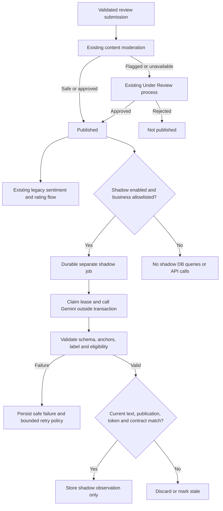

# Gemini review sentiment transition

Branch: `feat/gemini-review-sentiment-pipeline`, based on main `96222306`. First milestone: versioned isolated shadow storage, contract validation, background processing and recovery. This milestone does not activate a new authoritative sentiment pipeline or change public stars. Preserve this record for the eventual PR.

## Problem and direction

The existing VADER/DOST pipeline has language and ambiguous-feedback limitations. Development benchmarks favored Gemini; the label-only run matched 112/120 reviewed labels and the anchored-score prototype matched 111/120. These are synthetic, single-reviewer development examples, not independent final validation. The user also reviewed and accepted the prototype's 19 factual exclusions. Neither result establishes numerical intensity calibration or population-wide accuracy.

The agreed direction is all-language Gemini sentiment with a label, anchored score, rating eligibility and exclusion reason, while preserving the old implementation during transition. Content moderation, publication, community reports, merchant disputes and administrator decisions remain separate. Negative sentiment never means rejection. A factual review may remain published without contributing stars.

## This milestone

- `ReviewSentimentShadow` is separate from legacy Review sentiment fields, the one-to-one ReviewRatingResult, BusinessRating and BusinessReviewSummary. It has no public serializer/API and does not feed any existing consumer.
- A unique review/contract-version/exact-text-hash tuple stores the analyzed text, configured model identifier, durable job state, attempts, lease token/deadline, safe failure type and usage. Historical observations are retained until the review is deleted, which cascades them.
- Contract version is a digest of the configured model identifier, prompt, schema and policy identifier. Model aliases are not immutable provider revisions; changing behavior behind an alias is still an operational limitation.
- Strict validation accepts only the five anchors -1, -0.5, 0, 0.5, 1. Scores must agree with positive/negative/neutral labels. Factual or uncertain exclusions require neutral label, null score and false eligibility. Extra fields, booleans as scores, unsupported anchors and inconsistent outputs fail validation.
- Existing publication and accepted text-edit scheduling registers an independent after-commit observer. Legacy dispatch and inference are untouched. Callback failure logs only identifiers/error types and does not roll back a published review or prevent legacy processing.
- Observation demand is durable before broker dispatch. Broker failure leaves pending work for recovery. A database failure while creating after-commit demand can leave a missing observation; operators must requeue the explicitly selected review IDs. This milestone does not scan/backfill every published review.
- Workers claim under row locks in review-then-shadow order, commit before external inference, and publish only while the token, contract, text and published status still match. A lease allows duplicate deliveries to return busy and fences late workers after recovery.
- Up to three inference attempts per observation; transient provider failures and invalid output may retry with durable backoff. Permanent failures do not retry automatically. Expired worker claims are recoverable. Unexpected database/task failures leave durable demand or an expired lease for recovery.
- A periodic task dispatches at most 50 due existing jobs per invocation. It never creates historical observations. Configuration is checked before new inference and before result publication; disablement stops new calls but cannot cancel an already-sent HTTP request.

A ready row is a historical observation, not a guarantee that the review is still published or unchanged today. Any future reader/export must join the current review and check its publication, exact source text and active scoring contract. This milestone deliberately exposes no general reader that could mistake old observations for current rating inputs.

## Flow



There is intentionally no arrow from shadow observations to authoritative stars, review summaries, moderation decisions or discovery ranking in this milestone.

## Deployment and controlled pilot

Defaults are disabled with an empty cohort. Local `.env` was not changed and the application database was not migrated during development.

1. Review migration `reviews.0031_reviewsentimentshadow` and the target database's full migration plan. It creates one isolated table, index and uniqueness constraint. It contains no provider calls, data migration or score backfill. Pending prerequisites may also appear in a target plan.
2. Deploy/apply the reviewed plan through the normal database-owner process before enablement. Disabled code does not query the shadow table.
3. Configure only the intended environment, using actual pilot business IDs:

```dotenv
GEMINI_SENTIMENT_SHADOW_ENABLED=True
GEMINI_SENTIMENT_SHADOW_BUSINESS_IDS=12,34
GEMINI_SENTIMENT_SHADOW_MODEL=gemini-3.5-flash-lite
```

The example IDs are placeholders. Boolean values and positive ID syntax are validated at startup. An enabled flag with no allowed IDs produces no inference. Credentials and timeout reuse the existing server-side Gemini configuration. No client can select a business cohort or activate the feature through an API.

4. Restart backend and intended Celery worker/Beat processes through the existing supervisor, without starting duplicates. Both new tasks explicitly route to the `gemini_sentiment_shadow` queue; keep the legacy worker on its existing queue. A development shadow worker can use `celery -A config worker -P solo -Q gemini_sentiment_shadow -n shadow@%h -l info`. Verify registration of `apps.reviews.tasks.process_gemini_sentiment_shadow` and `apps.reviews.tasks.recover_gemini_sentiment_shadow`. Beat recovery runs every 60 seconds; configuration does not establish that live task delivery is working. The global Beat schedule contains other application jobs; do not start it against a partially migrated application database merely to test shadow recovery. The separate pilot report records the explicitly scoped dispatcher used locally.
5. Submit/edit a selected published review, or explicitly enqueue existing pilot review IDs:

```powershell
..\.venv\Scripts\python.exe -B manage.py queue_sentiment_shadow --review-id 101 --review-id 102
```

The command supports at most 100 IDs, respects the same cohort/publication gates and does not edit review data. It queues provider work, so it consumes quota when workers process it. Duplicate requests do not reset attempts or completed observations. Failed permanent/exhausted jobs require deliberate operator investigation; there is no automatic unlimited reset command.

6. Inspect pilot observations through trusted server-side tools, respecting current text/version/status. Confirm no public score, legacy field, summary, review status or moderation decision changed because of shadow work. Record provider usage, latency, errors and exclusion agreement. Shadow source text duplicates review text and inherits review deletion; evaluate retention/access before a broader pilot.

Pause by disabling shadow processing and restarting the affected processes. Retain the table and observations for review; no authoritative rollback is needed at this milestone. Removing the migration destroys shadow evidence, so do not reverse it merely to pause the experiment. Clear the cohort before any future broader rollout. The old VADER/DOST code remains intact.

## Later milestones and PR scope boundaries

Before public activation: independently annotate intensity/eligibility; validate new held-out comments and numerical error; explicitly decide the scoring policy and display disclosures. Classification accuracy is not rating calibration. The existing five-review minimum is a policy threshold, not a statistical guarantee.

Inventory and separately switch every sentiment consumer: rating aggregates, merchant/admin distributions, Vibe narratives/themes, filters, sentiment-outlier flags, exports and caches. Excluded rating inputs can still contain useful narrative/theme information. Do not silently mix versions or treat excluded reviews as rejected.

Future authoritative processing needs explicit selection/gates, a versioned writer for eligible and ineligible results, same-business aggregation, controlled backfill and lifecycle acceptance. Preserve stale-result fencing, edits/deletions/rejections and recovery. Rollback after authoritative activation will require explicit old-version selection/reanalysis and aggregate/cache reconciliation; simply turning Gemini off will not suffice.

Suggested PR title for this first milestone: `feat(reviews): add isolated Gemini sentiment shadow processing`.

Suggested PR description: Published reviews in an explicitly enabled business cohort can receive a separate, versioned Gemini observation without replacing legacy scores or public ratings. Adds strict anchored-score/eligibility validation, durable leased background jobs, bounded recovery, a pilot queue command, migration and transition guidance. Existing moderation and sentiment consumers remain authoritative. Validation evidence belongs in the PR after the final checks complete; live provider/worker acceptance and public cutover are separate work.

## Verification recorded on 3 November 2026

- Django system checks passed and `makemigrations --check --dry-run` reported no drift.
- 74 tests passed across new shadow contracts/services, existing sentiment services, business-rating calculation and rating lifecycle.
- PostgreSQL concurrency tests verified overlapping delivery makes one provider call and a reclaimed lease fences the late worker.
- Other checks cover disabled zero-query behavior, scoped publication, rollback/after-commit dispatch, broker failure recovery, malformed responses, bounded/permanent failures, edits/rejection/deletion during inference, factual null handling and pause during an in-flight request.
- Gemini was mocked; this run sent no review text to a provider. Django created and destroyed a disposable test database. The application database was not migrated.
- Whitespace checks passed. The initial test exposed savepoint queries in the disabled path; moving the gate before the transaction corrected that behavior and the final suite passed.
- `.env` was not edited; shadow enablement remains its default off unless an operator explicitly configures it. Live broker/worker/Beat behavior and controlled application-database rollout are not established by mocked tests.
- Changes are local and have not been committed or pushed. Earlier untracked datasets, prototypes, database backups and unrelated files were preserved rather than staged into this implementation.

## Subsequent live pilot evidence

The user authorized and completed a local controlled pilot after the disabled-by-default implementation checks. Reviews migrations 0029-0031 were applied to a backed-up local database, and local `.env` enabled business 11 only. Real worker delivery/inference, cohort exclusion and duplicate delivery passed. The user exercised submission, administrator approval, edit and deletion. A controlled transient failure then recovered through the real worker on attempt two, with no score stored on failure. Disposable fixtures were cleaned up. See `gemini-shadow-pilot-2026-11-03.md` for exact results, operating state, scheduler correction, unrelated narrative-refresh side effect, cleanup caveat and remaining limitations. These later actions do not change repository configuration defaults or establish an authoritative cutover.
