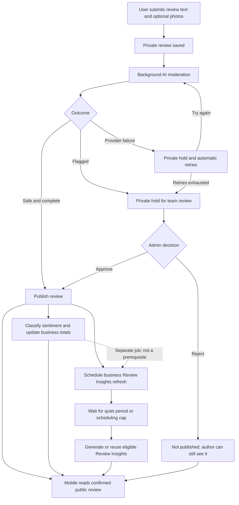
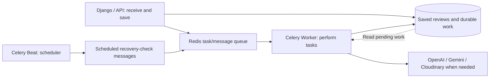
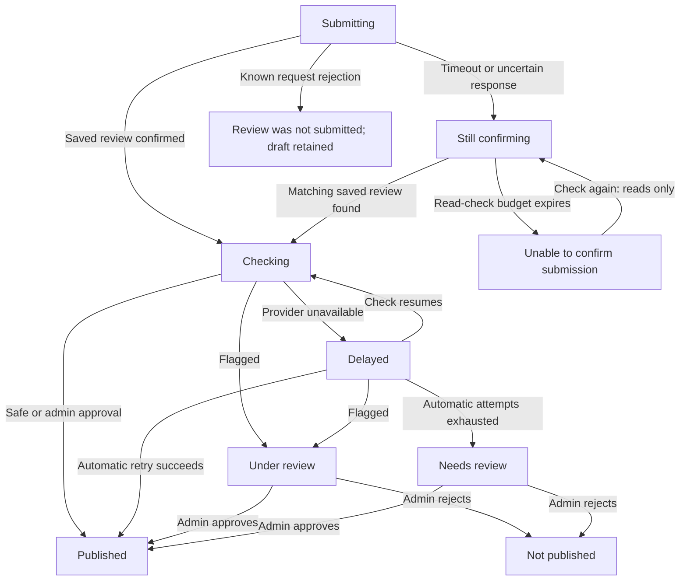
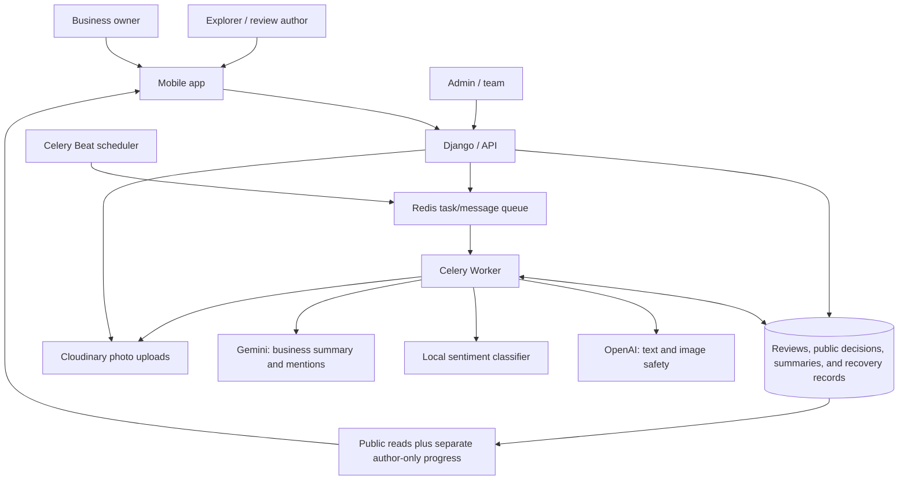

# SugboGo Review Lifecycle Architecture

For capstone teammates, advisers and panelists, and developers joining the project.

**Code inspected: 24 October 2026.** This guide describes the current backend and mobile working files, including changes already present in the workspace. It is based on implementation and representative tests, not earlier project reports. No application code, configuration, migrations, or runtime data was changed to prepare it. Deployment health, applied migrations, and live administrator settings were not checked.

## Overview

A SugboGo review moves through three separate kinds of processing:

| Job | Plain-language question | Result |
| --- | --- | --- |
| AI moderation | “Does this content need a safety review before it appears publicly?” | Automatic publication when safe, or a private hold for another check or a team decision. |
| Sentiment analysis | “Does the review sound positive, neutral, or negative?” | A tone label and score, used in business sentiment totals. |
| Review Insights | “What experiences keep appearing across this business’s recent reviews?” | A short generated summary and frequent mentions, supported by review evidence. |

**Moderation is not sentiment analysis. Sentiment analysis is not Review Insights.** A negative review can pass moderation and become public. A published review can appear before its sentiment is ready. Review Insights can refresh later still.

The phone shows progress, but the backend—the server that saves and manages reviews—decides what is public. Only published reviews contribute to public review counts. Private review content and progress are available to the author through author-specific reads; authorized administrators can also inspect held reviews for moderation.

## The Review Journey

### Main lifecycle

The arrows show related updates, not one blocking chain. Publication does not wait for sentiment or Gemini. Insights generation does not wait for sentiment classification either. The phone refreshes each result as it becomes available.

### Submitting a review

1. **The author writes text and optionally adds photos.** The current review form accepts 25–1,000 characters and up to three photos, each no larger than 10 MB. There is one review per author per business, and the business owner cannot review their own business.
2. **The phone immediately creates a temporary private card.** It retains the submitted text and local photo previews and shows “Submitting…”. This is feedback about the request, not proof of a saved or published review.
3. **The backend uploads the photos to Cloudinary**, the external service that stores and serves images.
4. **The backend saves the review and photo references privately.** Its initial state is `under_review`, with an explicit record that the first moderation check is still pending.
5. **After saving succeeds, the backend requests background moderation.** New-review submission does not call the AI moderation provider inside the original request.
6. **The phone receives a receipt identifying the saved review.** The composer normally closes with “Review received”; the author’s card shows that checking is in progress. A receipt confirms receipt, not publication.

The review starts private so unchecked text and images cannot enter public lists, increase the review count, earn review-publication rewards, or invite engagement before the publication decision.

**Specialty-tag vouches are separate actions.** A vouch means the user endorses a business specialty, such as a particular strength of the business. The current review composer does not submit vouches with review text and photos. When a saved review is displayed, the backend attaches that author’s existing vouches for the business’s currently active specialty tags. They are not a frozen selection stored at review submission. Vouches have their own counts, rewards, and notification flow; review moderation does not control those separate actions. A temporary submission card does not invent vouches.

The author may also choose whether a published review appears in the Community feed. Turning that off does **not** make a published review private: it remains eligible for the business’s public reviews, public count, and recent-review analysis.

## AI Moderation

### What is checked

The background worker checks the saved review text and each saved image separately through OpenAI’s moderation service. It records the provider’s safety findings and which photo each finding belongs to. These are safety checks, such as concerns involving threats or abusive content; they do not decide whether a customer’s opinion is favorable or factually correct.

A small local rule set also recognizes specific direct violent threats in Cebuano. It supplements the provider; it is not a complete Cebuano language or truthfulness detector.

SugboGo also records advisory reliability signals, including duplicated text, rapid submissions, and accounts sharing an app installation. These signals support later investigation. They are separate from the automatic safety decision and do not by themselves block publication. An unavailable reliability check is recorded as unavailable rather than treated as proof of abuse.

### The three outcomes

| Outcome | What SugboGo does | What the author sees |
| --- | --- | --- |
| Safe | Publishes only after the complete check succeeds and the saved content still matches what was checked. | The normal published review card. |
| Flagged | Keeps the review private for the team. Automatic provider-failure retries stop. | “Under review.” |
| Provider failure | Keeps the review private and records another attempt, if the retry budget remains. This includes unavailable service, missing credentials, or unusable/incomplete results. | “Delayed,” or “Needs review” once retries are exhausted. |

If the provider already flags text or an image before another part of the check fails, the result stays flagged. Incomplete checks cannot authorize publication. A local Cebuano finding does not prevent recovery from a separate provider outage; after the check completes, a flagged finding still prevents automatic publication.

### Why AI never directly rejects a new review

The implemented automatic choices are **publish when safe** or **keep private**. A flag is a reason for a person to inspect the review, not a final rejection. A provider outage also says nothing about whether the content should be rejected. The admin/team makes the rejection decision.

### Automatic retries and exhaustion

The backend saves retry progress with the review, so recovery does not depend solely on one message reaching the worker.

The current retry sequence has a detail worth preserving accurately:

- If the initial check fails, an immediate recovery attempt is requested.
- If that attempt and later attempts keep failing, the next delays are **60, 120, and 240 seconds**.
- If the final attempt also fails, automatic attempts stop and the review remains private for team review.

This allows an initial assessment plus up to four recovery assessments when every call fails. The internal `MAX_RETRIES = 3` covers the delayed retry sequence after the immediate recovery attempt; it does not mean only three provider calls in total. Actual start times can be later because of queue delays or outages.

Each active check has temporary ownership that expires after 120 seconds. If a worker disappears mid-check, recovery can reclaim the work after that ownership expires. Duplicate messages cannot validly publish the same held review twice.

## Publishing

A new review becomes public when a complete safe moderation result is accepted, or when an authorized admin approves the held review.

Publication is the common starting point for these effects:

- A first-publication time is recorded.
- The business’s public review counter increases.
- The author receives the applicable review reputation reward, with a photo-specific reward path when photos are present. Reputation is the project’s contribution reward system.
- The business owner receives a “New review received” notification. A unique notification identity prevents duplicate notices for the same publication.
- Sentiment work is queued, and eligible text changes are recorded for a later Review Insights refresh.
- The review becomes available for public engagement, subject to the normal ownership rules.

These changes are coordinated as one saved decision. Background requests are sent only after that decision has been saved. This avoids acting publicly on an unfinished or rolled-back submission.

The author notification for an **admin** approval or rejection is a separate part of the admin decision flow. The automatic safe-publication path notifies the business owner; it does not call that admin-resolution notification path.

Public lists and their counts select published reviews only. The author’s private review is returned separately, so showing it above a public list does not add it to that list’s public total.

## Editing a Review

Editing an existing review follows a different path from first-time submission.

| New submission | Edit |
| --- | --- |
| Saves a private review, then checks it in the background. | Checks changed text or newly added images during the edit request, before saving the replacement. |
| An unsafe or unavailable check leaves a saved private review for recovery or team review. | A flagged or unavailable check refuses to apply the proposed edit; the saved version stays intact. |
| Can enter the durable initial-moderation retry flow. | The proposed edit is not saved as a separate pending version and does not enter that retry flow. |

For a published review, readers continue seeing the existing approved content while an edit is checked. The mobile composer keeps the proposed text and photos if the edit cannot be accepted, so the author can adjust them or try later. A flagged **edit** is refused without automatically rejecting the already-saved review.

When text changes or new photos are added, moderation covers the proposed text, the new photos, and the retained photos. Removing photos alone or changing only Community visibility does not trigger a new provider check. Reviews currently `under_review` cannot be edited. Passing an edit check does not itself change a non-published review into a published one.

After the check, new photos are uploaded. Before saving, SugboGo verifies that the review and photo selection still match the version the author started editing. If another action changed them, the edit returns a conflict instead of overwriting newer work.

On an accepted edit:

- Selected existing photos remain; removed or replaced photos get durable cleanup records.
- Changed text loses its old sentiment label and score and is queued for fresh classification. The business sentiment totals are recomputed without that old classification.
- A meaningful change to eligible published text schedules Insights regeneration. Generated content citing the changed review is invalidated immediately when applicable.
- Photo-only edits do not trigger text-based Insights regeneration. Adding a review’s first photo can use the existing photo-upgrade reputation reward path for published reviews.

## Sentiment Analysis

### Classifying an individual review

Sentiment describes the tone of the review text: **positive**, **neutral**, or **negative**. For example, praise about helpful staff may be positive, while a complaint about waiting may be negative. This is an estimate by software, not a verdict on safety or truth.

The current classifier runs locally on the server. It detects language and sends confidently identified English text to an English scoring tool called VADER. Other text goes to a locally installed Filipino/Tagalog sentiment model. This routing includes Cebuano or mixed-language text; the code does not provide a dedicated Cebuano sentiment model. Classification can be imperfect.

Only published reviews are scored by this workflow. Before saving a result, SugboGo rechecks that the review still exists, is still published, and still contains the text that was analyzed. A result for older text is discarded.

### Building a business sentiment summary

The business summary counts positive, neutral, and negative published reviews **created within the past 30 days**. The window uses submission/creation time, not publication or edit time. Approving an old review does not restart its 30-day eligibility window.

The system stores both the number of eligible reviews and the number with recognized sentiment labels. Percentages use only the classified reviews. For example, six positive, two neutral, and two negative classifications produce 60%, 20%, and 20%; unclassified reviews do not become neutral votes.

The overall vibe needs enough classified reviews. The code’s default minimum is five, but the live threshold comes from administrator-managed analytics settings. Once sufficient, a category is “mostly” dominant when it has at least 55% and leads the next category by at least 15 percentage points; otherwise the vibe is “mixed.”

These recent-review sentiment totals differ from the business’s all-time public review count.

### What `sentiment_aggregate_included` means

In plain language, this author-only field means:

> “The stored business sentiment totals include this exact current version of your review and its classification.”

A saved positive label alone does not prove the business totals were updated. SugboGo stores a content signature—a compact identity for the review version used in the totals—and compares it with the current review. Changed text, changed classification, a private state, or falling outside the 30-day window prevents a positive confirmation.

This field does not mean the review has been included in a Gemini narrative. It confirms sentiment aggregation only.

### Repairing failed aggregation

Classification is saved separately from the business totals. If classification succeeds but updating the totals fails, the label can remain saved while `sentiment_aggregate_included` is false.

Reprocessing that review recomputes the totals even when the label and score are already present, without rerunning classification unnecessarily. Business-level reconciliation also fills missing classifications and rebuilds the totals. The configured daily review-summary job performs this repair across businesses; an explicit full admin refresh also requests business sentiment reconciliation.

The individual sentiment task logs a failure and returns; it does not automatically schedule an immediate task retry. Mobile polling only reads progress and cannot repair server totals. Therefore a missed or failed update can wait for later processing, an admin refresh, or the daily repair job.

## Review Insights

### What they contain

Review Insights combine a short English summary of recurring experiences with frequent mention tags, such as topics visitors repeatedly discuss. Gemini generates the summary and tags from eligible review **text**. Photos, likes, and specialty vouches are not its source material.

Sentiment counts are calculated separately. Gemini does not decide the public review count, sentiment percentages, or whether a review is safe to publish. Frequent mention tags are generated topics, not the business’s specialty-vouch tags and not automatically positive or negative labels.

The eligible population is published, nonblank review text created in the past 30 days. The live analytics policy controls the minimum number of reviews and the support needed for a frequent mention. Code defaults are five eligible reviews and two supporting reviews per mention; this guide does not assume those defaults equal the deployment’s current settings.

The generator analyzes at most 100 reviews, evenly spread through the eligible set when more are available. Its requested summary is at most two sentences and 60 words, with up to 20 mention tags. The output must supply supporting review references, and SugboGo validates the structure, limits, and references before saving it. Mention counts describe support in the analyzed set; they are not estimates for all customers.

### Why generation waits

A burst of reviews should normally cause one business summary refresh, rather than a separate Gemini call for every review. SugboGo saves the need for a refresh and waits for the input to settle.

- **120-second quiet period:** when a committed change is observed, the target time moves to 120 seconds after the latest observed change.
- **600-second scheduling cap:** repeated changes cannot keep extending that target past 600 seconds after the first observed change in the outstanding batch.

The due time is the earlier of those two targets. Timing begins when committed changes are observed; a recovery check can perform that observation if the original callback was missed.

For example, if the first change is observed at 10:00 and another at 10:01, the quiet-period target becomes 10:03. If changes keep arriving, that batch’s scheduling deadline cannot move beyond 10:10.

**The cap limits postponement, not completion time.** Scheduler intervals, waiting tasks, provider duration, service outages, and retry backoff can all make completion later. If too few reviews qualify, the system records “insufficient reviews” without calling Gemini. If existing content is already current, it can reuse it without a new provider call.

Publication, eligible text edits, deletion, rejection, analytics-policy changes, and reviews aging out of the window can create refresh work. Sentiment completion alone does not schedule another narrative generation.

### Failure recovery and older summaries

The need for generation remains saved independently of the queue message. Failed generation records a retry delay that grows through 60, 120, and 240 seconds and then caps at 300 seconds. The coordinated regeneration path keeps work outstanding; it has no equivalent of moderation’s final “retries exhausted” cutoff.

The periodic recovery check finds due work, missed observations, and abandoned worker ownership. A missing Gemini key, connection failure, or invalid output cannot produce a fresh “ready” summary merely because an attempt occurred.

A previous summary may remain available while newer work is pending or fails **only when its supporting evidence and generation rules remain valid**. Mobile can label it as previous insights that may not reflect the latest reviews. Editing, deleting, or rejecting cited evidence can clear the old narrative and tags immediately. Expired evidence is also hidden by the public read checks while recovery catches up. The compact business-profile preview currently hides the Insights block when no usable generated summary is available.

### Why stale generation cannot overwrite newer data

Think of each requested refresh as a numbered revision, and each worker as holding a temporary ticket to process one revision.

Before saving Gemini’s answer, SugboGo checks that:

1. The worker still owns the current, unexpired ticket.
2. Its revision is still the latest requested revision.
3. The eligible review texts and generation rules still match what it analyzed, including reviews expiring while Gemini was working.
4. The saved result and completion acknowledgement can succeed together.

If newer changes arrived, or another worker replaced the expired ticket, the old result is discarded. The code also includes a storage-level guard against generated-content writes without current ownership. That guard is defined in the repository migration; whether it has been applied in a particular deployment was not checked for this document.

## Background Processing: Celery, Redis, Worker, and Beat

The Django/API layer is the service desk: it handles phone requests and saves authoritative decisions. Celery is the background-job system used to pass work away from that desk.

| Component | Analogy | Actual responsibility |
| --- | --- | --- |
| Redis | The task/message queue, like an inbox or work tray. | Carries job messages to workers. It is not the authoritative review record. |
| Celery Worker | A background worker picking jobs from the tray. | Performs moderation, sentiment, Insights generation, cleanup, and the recovery jobs themselves. |
| Celery Beat | A scheduler with a recurring checklist. | Periodically queues recovery and maintenance checks. It does not perform those checks or call AI by itself. |
| Persistent application storage | The saved case file and to-do ledger. | Retains reviews, decisions, pending moderation, Insights revisions, and photo-cleanup work across delivery failures. |

### Background processing flow

Both Worker and Beat are needed. A running Worker can process directly queued moderation and sentiment even if Beat is absent. However, the current normal Insights path relies on Beat’s recurring recovery scan to dispatch due generation work. Beat also rescues missed moderation and cleanup messages. A running Beat without a Worker merely adds messages to the tray.

The current configured review-related schedule is:

| Scheduled work | Frequency |
| --- | --- |
| Recover initial moderation and provider-failure retries | Every 30 seconds. |
| Observe and dispatch due Insights regeneration; recover abandoned ownership and window expiry | Every 30 seconds. |
| Recover pending media cleanup | Every five minutes. |
| Reconcile business review summaries, including missing sentiment and totals | Daily at 03:00 in the configured Celery timezone. |

The checked settings use UTC, so that daily 03:00 run corresponds to **11:00 AM Philippine time**. These are configured schedules, not evidence that the processes are currently running or a promise of exact completion times.

## Mobile Experience and Synchronization

### Review state flow

A confirming read can discover a review already published, rejected, or awaiting team review; the phone adopts its actual saved state. “Checking” in the diagram represents the usual pending case, not a forced intermediate step.

| User-facing state | Meaning in the current implementation |
| --- | --- |
| Submitting | The phone is sending the request. A local card is not yet authoritative. |
| Checking | A saved review is waiting for its first check or being checked. Routine cards say “Checking before publishing · Only you can see this.” |
| Delayed | The review is saved, but the provider check needs another attempt. Routine cards say “Taking a little longer than usual · Only you can see this.” |
| Under review | A flag requires a team decision, or the backend cannot describe a more specific held state. |
| Needs review | Automatic provider checking exhausted its retry budget. The review remains private for the team. |
| Not published | The saved review is rejected and remains visible to its author. A legacy flagged record without progress data also uses this conservative label. |
| Still confirming | The phone does not yet know whether the server received the submission. It tells the user they do not need to submit again. |
| Unable to confirm submission | The phone’s bounded confirmation checks ended without a match. This does not prove the submission failed. “Check again” resumes reads. |

### How temporary cards become confirmed reviews

The receipt supplies a real review ID. The phone then reads the author’s review from the existing private preview/history paths and replaces the temporary content with server-confirmed content. It avoids displaying a second card when the real review is already represented in the list.

If the request response was lost, matching is more cautious: it checks the current account/session and business, text, photo count, creation time, and previously known review IDs. It does not assume any review for that business must be the new submission.

Temporary workflow data is session-only. It is cleared when the account/session changes and is not a permanent offline draft store. The backend’s saved review remains the source of truth.

### A timeout does not necessarily mean failure

The current creation request allows 30 seconds without photos and 120 seconds with photos. A timeout can happen after the server has already saved the review but before the phone receives the receipt.

The app therefore does **not** automatically resend an uncertain creation request. It preserves the local content and checks private reads about every five seconds for up to 60 seconds while the relevant screen is active. If confirmation remains unavailable, it shows “Unable to confirm submission.” “Check again” starts another read-only confirmation window; it does not upload a duplicate review. Known validation or permission rejections instead keep the draft available to correct and resubmit.

### Publication, sentiment, and Insights arrive independently

The phone observes held author reviews at roughly 30-second intervals within a bounded foreground window of up to 12 minutes. It uses shorter polling during active derived-data synchronization: approximately two seconds, with a 45-second sentiment window and up to 12 minutes for tracked generated Insights. These observation budgets do not cancel server work or change moderation decisions.

Polling respects screen focus, app activity, connectivity, and account ownership. Narrative polling stops on navigation; a short existing sentiment synchronization may continue while the app remains active. Normal screen entry, focus, reconnect, and manual refresh can pick up results that finish later. Multiple screens share polling ownership to avoid redundant timers.

When publication or rejection is observed, the app refreshes affected review lists, the author’s history, business details/cards, activity data, and Community data. Sentiment completion waits for `sentiment_aggregate_included`, rather than treating a saved label as proof the totals are ready. Insights completion follows server revision progress, so an older summary or response does not acknowledge newer work accidentally.

Temporary cards and held reviews never increment public counts. The phone takes those totals from the backend and keeps author-only feedback outside public list membership. Seeing your own private card is not evidence that other users can see it.

## Engagement

**New likes and new merchant replies require a published review.** This keeps public interaction attached to content that has passed the publication decision.

- Likes are limited to one per user per review. The current service prevents a merchant from liking reviews on their own business.
- Only the business owner can reply to that business’s review. There is one merchant reply per review, which the owner can manage with text and optional photos.
- The mobile card hides ordinary engagement controls for private reviews.

The server briefly gives each competing action its turn on the same review. It rechecks publication and permissions before creating engagement. This prevents a like or reply from slipping through using an earlier “published” view while another action is removing or rejecting the review.

Duplicate guards prevent repeated requests from creating a second like or reply. Like counts change only when a like was actually created or removed, and removal cannot push the count below zero. Reply edits also check that their starting version is still current before replacing it.

The publication rule concerns creating engagement. Removing an existing like, and managing an already-existing reply through its authorized paths, are separate operations; the code does not require a new publication decision for every cleanup action.

## Media Handling

### Uploads and unsuccessful submissions

Cloudinary stores the images; SugboGo saves their URLs and cleanup identifiers. On first submission, uploads happen before the private review is saved. On edits involving new photos, the proposed content is checked before those new uploads are attached.

If an upload or subsequent save fails, SugboGo attempts to delete uploads already known to have succeeded. Before doing so, it checks whether an image is attached to a saved review, protecting images that were actually saved even if a later request step failed.

**This failed-upload compensation is best effort.** It does not create durable cleanup records. If the attachment check or Cloudinary deletion fails, the code logs the problem for manual inspection. An upload whose identifier was never received cannot be cleaned up through the known-identifier path. This differs from the recoverable deletion flow below.

### Deleted and replaced photos

For removed/replaced review photos and deleted reviews, SugboGo saves cleanup work together with the content change, before sending background deletion requests. Cleanup records survive deletion of the review itself. Whole-review deletion also records associated reply photos and merchant-dispute evidence assets for cleanup.

The worker asks Cloudinary to remove each recorded asset. “Already missing” counts as successful cleanup. Temporary failures receive increasing delays of 60, 120, and 240 seconds, with up to four total attempts. Certain permanent errors, such as authorization failures, stop sooner. The five-minute recovery scan redispatches pending work if the original message was lost.

After attempts are exhausted or a permanent error occurs, the record remains marked as requiring intervention. Once the cause is fixed, an operator can requeue selected failed records using the provided cleanup management command.

This design lets the review disappear from application reads without waiting for Cloudinary. It does not claim that every physical image disappears instantly. “Private review” here describes access through SugboGo’s review lists and author reads; these review images use Cloudinary URLs, and this flow does not implement signed author-only image delivery.

## Admin Moderation

Administrators can inspect held review text, photos, and the recorded reasons. The held-review queue includes pending checks as well as flagged or failed checks; an admin does not need to wait for automatic retries to finish before resolving a held review.

**Approval** uses the same publication path as a safe automatic check, including the public count, reputation, owner notification, sentiment request, and eligible Insights scheduling. The admin decision also records who acted and notifies the author.

**Rejection** keeps the review non-public, requires explanatory moderation notes, records the decision, and notifies the author. It removes excluded evidence from business summaries as needed. A review that was never published has no public count to subtract.

An admin decision and an AI result may arrive almost together. SugboGo handles this like a case folder that only one decision-maker may update at a time:

1. The admin reopens the current saved state before deciding.
2. Approval or rejection saves the final state together with its related effects and audit record.
3. A returning worker must recheck that the review is still held, its content is unchanged, and its temporary ownership is still valid.
4. If the admin has already decided, the worker discards its result. It cannot republish a rejection or apply publication effects a second time.

If the worker published first, a later held-review decision request finds that the review is no longer eligible for that queue and is refused. The admin must use the applicable post-publication moderation flow rather than overwrite an already-resolved held case.

Publication is not permanent immunity from moderation. Later reports or merchant disputes have their own team-resolution paths. Rejecting a previously published review removes it from public membership, reduces the public counter once, and updates sentiment and generated evidence through the consistency services.

### Author deletion

An author can delete their review, including a held one. Deletion removes the saved review, registers media cleanup, and updates affected summaries. The public count decreases only if that review was published. Pending reports and merchant disputes are captured in an audit record and their submitters are notified that the author removed the content. Late background checks cannot recreate a deleted review.

## Failure & Recovery

| Example | What SugboGo does | What restores progress |
| --- | --- | --- |
| OpenAI is temporarily unavailable | Keeps a new review saved privately, records provider failure, and shows delayed checking. No public count or publication reward is added. | Immediate recovery attempt, then 60/120/240-second delayed attempts. Exhaustion leaves it for the team. An edit instead keeps the previously saved content and returns feedback to the author. |
| A Worker stops | Already-saved reviews remain saved. Background moderation, sentiment, generation, and cleanup stop making progress on that worker. | A running/restarted Worker processes available tasks. Beat-driven recovery can redispatch pending moderation and cleanup and reclaim expired moderation/Insights ownership. Missed sentiment can be repaired by reconciliation. Recovery is not an instant completion guarantee. |
| Beat is not running | Directly delivered jobs may still run on a Worker, but periodic rescue checks and daily repairs stop. Normally due Insights work is not automatically dispatched by its recurring scan. | Restart Beat and keep a Worker running. Saved pending work can then be discovered. Worker alone does not replace Beat’s schedule. |
| Redis is unavailable | Some job delivery fails even though the review or outstanding work was saved. | When Redis, Worker, and Beat are available again, durable moderation, Insights, and deletion-cleanup work can be redispatched. Sentiment uses later reconciliation if its initial message was missed. |
| Sentiment classification succeeds but aggregation fails | The review stays public and keeps its saved label; exact inclusion in stored totals is not yet confirmed. | Reprocessing reuses the classification and rebuilds totals. Business reconciliation, a full admin refresh, or the daily summary job can repair it. Mobile reads do not perform this repair. |
| The local sentiment model is unavailable | The published review remains public; classification failure is logged. No neutral label is invented. | Restore the required local model files/dependencies, then reconciliation can fill missing classifications. |
| Gemini generation fails | Public reviews and sentiment remain available. Insights work stays outstanding with increasing retry delays, capped at 300 seconds. Safe older content may remain explicitly outdated; invalid evidence is cleared or hidden. | Beat’s recovery scan and a Worker retry the saved work. Missing configuration or persistent invalid output needs the underlying cause fixed. There is no fixed final retry cutoff in this coordinated path. |
| The mobile creation request times out | The phone keeps the draft and says “Still confirming”; the server may already have saved it. It does not automatically resend. | Private read checks adopt a matching saved review. After the confirmation budget expires, “Check again” repeats reads, not submission. |
| Cloudinary deletion fails for recorded removed media | The content change remains saved; cleanup work survives with attempts and due time. | Worker retries and Beat’s five-minute recovery scan process pending records. Exhausted/permanent failures require operator intervention and explicit requeue. |
| Cleanup of uploads from a failed request also fails | The original request still fails, and the cleanup problem is logged. There is no durable cleanup record for this compensation path. | Manual inspection of the logged asset identifiers; do not assume Beat will retry these orphan uploads. |

Saved recovery records make these failures recoverable within the implemented paths. They do not replace working infrastructure, valid provider credentials, available local models, or operator action for persistent failures.

## Simple Architecture Diagram

The API and worker share the same saved case information. The phone reads the outcomes through the API; it does not decide publication or directly consume the worker’s task queue. Normal review reads return stored information rather than calling Gemini on every visit.

## Implementation Evidence

These links identify the current implementation used for this guide. They are an optional starting point for developers, not an API reference. Paths are relative to this document.

| Area | Primary implementation inspected |
| --- | --- |
| Submission, publication, edits, deletion, photo compensation, public/author separation, and attached vouches | [Review service](../apps/reviews/services/review_service.py), [review views](../apps/reviews/views/review_views.py), [review validation and author progress](../apps/reviews/serializers/review_serializers.py). |
| Safety checks and automatic recovery | [Moderation service](../apps/reviews/services/review_moderation_service.py), [Cebuano fallback](../apps/reviews/services/review_cebuano_safety_fallback.py), [moderation retry service](../apps/reviews/services/review_moderation_retry_service.py). |
| Sentiment and exact aggregate inclusion | [Sentiment processing](../apps/reviews/services/review_sentiment_service.py), [local classifier](../apps/reviews/services/sentiment.py), [business sentiment summaries](../apps/reviews/services/business_review_summary_service.py), [vibe calculation](../apps/shared/analytics/review_vibe.py). |
| Insights timing, ownership, generation, and public display | [Scheduling](../apps/reviews/services/review_insight_scheduling_service.py), [regeneration coordination](../apps/reviews/services/review_insight_regeneration_service.py), [claimed generation](../apps/reviews/services/business_review_insights_service.py), [Gemini input/output and evidence](../apps/reviews/services/review_keyword_service.py), [public Insights serialization](../apps/explorer_operations/explore_businesses/serializers/review_insights_serializers.py). |
| Background jobs and policy defaults | [Review tasks](../apps/reviews/tasks.py), [daily reconciliation](../apps/reviews/services/review_summary_batch_service.py), [configured schedules](../config/settings.py), [timing constants](../apps/reviews/constants.py), [analytics policy defaults](../apps/admin_operations/system_configuration/analytics_policy_definitions.py). |
| Admin decisions and engagement | [Held-review decisions](../apps/admin_operations/moderation/services/manage_under_review_service.py), [rejection consistency](../apps/reviews/services/review_moderation_consistency_service.py), [likes](../apps/reviews/services/review_like_service.py), [merchant replies](../apps/reviews/services/review_reply_service.py), [notification events](../apps/notifications/services/notification_event_service.py). |
| Media cleanup | [Durable cleanup service](../apps/reviews/services/review_media_cleanup_service.py), [Cloudinary integration](../apps/shared/services/cloudinary_service.py), [operator requeue command](../apps/reviews/management/commands/retry_review_media_cleanup.py). |
| Mobile request and temporary-card reconciliation | [Review request service](../../sugbogo_frontend/mobile/src/features/explore/api/reviewBusiness.service.ts), [review mutations](../../sugbogo_frontend/mobile/src/features/explore/hooks/useBusinessReviews.ts), [session-only workflow](../../sugbogo_frontend/mobile/src/features/explore/stores/reviewWorkflow.store.ts), [temporary author cards](../../sugbogo_frontend/mobile/src/features/explore/components/business-profile/reviews/AuthorReviewSubmission.tsx). |
| Mobile states and independent refresh | [Status wording](../../sugbogo_frontend/mobile/src/features/explore/utils/reviewModeration.utils.ts), [author status display](../../sugbogo_frontend/mobile/src/features/explore/components/business-profile/reviews/AuthorReviewStatus.tsx), [polling and completion checks](../../sugbogo_frontend/mobile/src/features/explore/hooks/ReviewDerivedDataSyncProvider.tsx), [affected-read refresh](../../sugbogo_frontend/mobile/src/features/explore/utils/reviewPublicationSync.utils.ts), [compact Insights display](../../sugbogo_frontend/mobile/src/features/explore/components/business-profile/reviews/review-preview-section/ReviewInsightsPreview.tsx). |

Representative existing tests inspected include [private asynchronous creation](../apps/reviews/services/tests/test_review_async_creation.py), [initial moderation and retry timing](../apps/reviews/services/tests/test_review_initial_moderation.py), [retry exhaustion](../apps/reviews/services/tests/test_review_moderation_retry_task.py), [exact sentiment inclusion and aggregation repair](../apps/reviews/services/tests/test_sentiment_provenance.py), [upload compensation](../apps/reviews/services/tests/test_review_upload_compensation.py), [mobile uncertain-submission reconciliation](../../sugbogo_frontend/mobile/src/features/explore/hooks/__tests__/ReviewSubmissionReconciliation.test.tsx), and [mobile moderation synchronization](../../sugbogo_frontend/mobile/src/features/explore/hooks/__tests__/ReviewModerationSync.test.tsx). The [publication-guard migration](../apps/reviews/migrations/0026_review_insight_publication_fence.py) defines the extra generated-content write safeguard. These tests were read as evidence; they were not run and no test database was created for this documentation task.

## Glossary

| Term | Simple meaning |
| --- | --- |
| API | The server interface the phone uses to send requests and read saved results. |
| Backend / Django | SugboGo’s server application, which validates requests and manages saved records. |
| Publication | The decision that makes a review public and activates publication effects. |
| Moderation | Safety checking and the team’s decision about whether content may be published. |
| Provider failure | A check could not finish reliably; this is not a content rejection. |
| Sentiment | The estimated positive, neutral, or negative tone of review text. |
| Aggregation | Combining individual classifications into business totals and percentages. |
| Review Insights | A generated business-level summary and recurring topics from recent eligible reviews. |
| Vouch | A separate endorsement of a business specialty. |
| Queue / Redis | The inbox of background-job messages. |
| Celery Worker | The process that performs background jobs. |
| Celery Beat | The process that periodically sends scheduled-job messages. |
| Retry / backoff | Trying again after a failure, with a waiting period between attempts. |
| Reconciliation | Comparing saved work and results with current reviews, then repairing missing or outdated processing. |
| Quiet period | A pause that groups nearby changes before refreshing Insights. |
| Revision | A numbered request for an updated result. |
| Claim / lease | A worker’s temporary right to process a particular piece of work; it expires so abandoned work can recover. |
| Fingerprint / content signature | A compact identity used to check whether the analyzed input still matches current content. |
| Concurrency protection | Rules that stop overlapping actions from duplicating effects or overwriting newer decisions. |
| Cloudinary | The external service storing and delivering uploaded media. |
| Cleanup compensation | An attempt to undo already-completed uploads after the overall request fails. |

## In one sentence

SugboGo saves new reviews privately, publishes them after a safe check or team approval, updates sentiment and business Insights through separate recoverable background jobs, and keeps the phone synchronized with the saved outcome.
